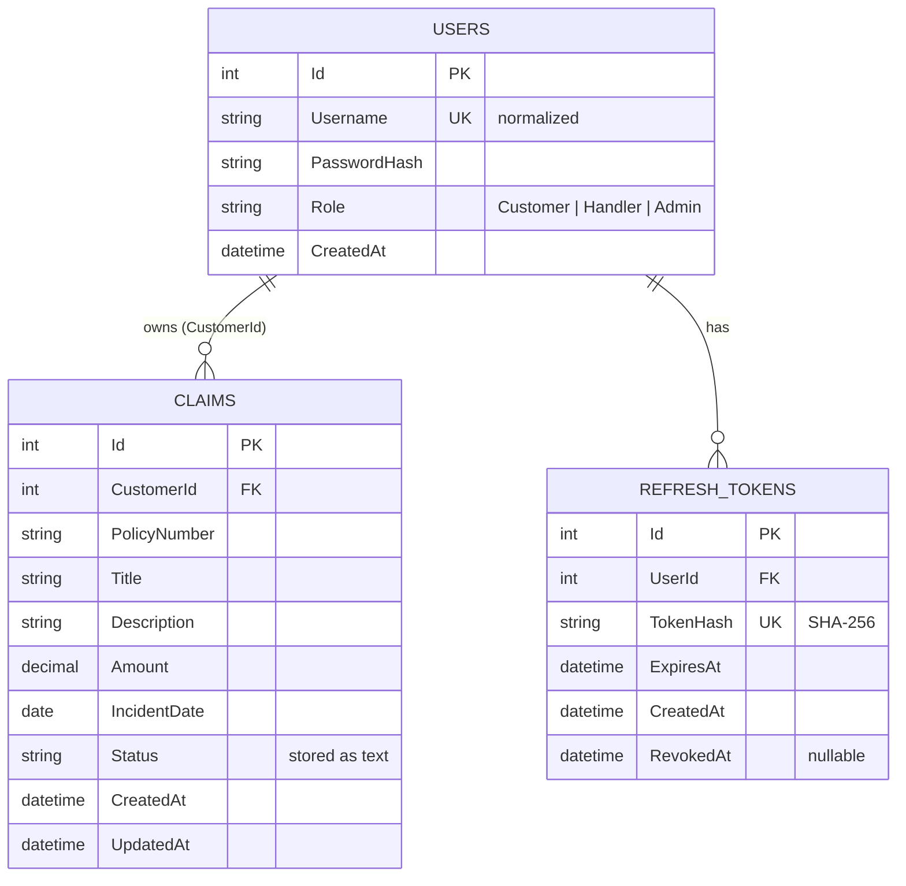

# Claims API


An insurance claims REST API built with ASP.NET Core, EF Core and PostgreSQL, deployed to Azure. Customers submit and manage their own claims, Handlers review every claim and approve or reject it, and Admins create Handler accounts.

## Live demo

| Environment | Swagger UI | Health |
| --- | --- | --- |
| Production | [Swagger](https://claims-api-jungah-h3fre0dfd8asbeed.swedencentral-01.azurewebsites.net/swagger) | [/health](https://claims-api-jungah-h3fre0dfd8asbeed.swedencentral-01.azurewebsites.net/health) |
| QA | [Swagger](https://claims-api-jungah-qa.azurewebsites.net/swagger) | [/health](https://claims-api-jungah-qa.azurewebsites.net/health) |

The free-tier host can take 10–30 seconds to respond after a quiet period.

**Demo accounts** (QA)

| Role | Username | Password |
| --- | --- | --- |
| Customer | `emma` | `demo-password` |
| Handler | `qa-handler` | `demo-password` |
| Admin | `qa-admin` | `-tefma7-vitbot` |

Use the QA environment to try the API. Production accounts are available on request.

**Try it in Swagger**

1. Open the QA Swagger UI and call `POST /api/auth/login` with one of the demo accounts above and copy the `accessToken`.
2. Click **Authorize**, paste the token (without `Bearer `) and click **Authorize** again.
3. Log in as the Customer to file and manage claims, as the Handler to see every claim and change statuses, or as the Admin to create Handlers.

**Create a Handler as Admin**

1. Call `POST /api/auth/login` with the QA Admin account and copy the `accessToken`.
2. Click **Authorize** and paste the token. If you are already authorized as another user, click **Logout** first.
3. Call `POST /api/admin/users` with a new username and password:

   ```json
   {
     "username": "<choose a new username>",
     "password": "demo-password"
   }
   ```

4. The response is `201` with `"role": "Handler"`. You can now log in with the new account and use the Handler features.

The new account is always a Handler. A Customer or Handler token gets `403`, and an existing username gets `409`.

## Features

- Create, list (newest first, optional status filter), read, update and delete claims
- Status workflow: `Received` → `InReview` → `Approved` or `Rejected`. Approved and rejected claims are final; any other transition returns 409.
- Only `Received` claims can be edited or deleted
- Registration (always as Customer), login with JWT access tokens (60 min) and refresh tokens (7 days, rotated on every use), logout
- Roles: Customer, Handler, Admin
- ProblemDetails for errors, and a health check that verifies the database connection

## Roles and permissions

| Endpoint | No token | Customer | Handler | Admin |
| --- | --- | --- | --- | --- |
| `POST /api/auth/register`, `login`, `refresh`, `logout` | ✓ | ✓ | ✓ | ✓ |
| `GET /api/auth/me` | 401 | ✓ | ✓ | ✓ |
| `GET /api/claims`, `GET /api/claims/{id}` | 401 | own | all | own |
| `POST /api/claims`, `PUT` / `DELETE /api/claims/{id}` | 401 | own | own | own |
| `PATCH /api/claims/{id}/status` | 401 | 403 | ✓ any claim | 403 |
| `POST /api/admin/users` (create Handler) | 401 | 403 | 403 | ✓ |
| `GET /health` | ✓ | ✓ | ✓ | ✓ |

## Tech stack

.NET 10 · ASP.NET Core controllers · EF Core 10 · PostgreSQL 17 · xUnit + Testcontainers · GitHub Actions · Azure App Service (F1) · Azure Database for PostgreSQL Flexible Server (B1ms)

## Architecture

Controllers handle HTTP and map results to status codes. Services (`ClaimService`, `AuthService`) apply business rules, `ClaimStatusTransitions` decides which status changes are allowed, and `AppDbContext` talks to PostgreSQL.

## Data model



## Design decisions

**Security**

- **Secure by default.** A fallback authorization policy requires a logged-in user on every endpoint. Only the auth endpoints, `/health` and the OpenAPI document are explicitly opened.
- **Other customers' claims return 404, not 403**, so the API never confirms that someone else's claim exists.
- **Roles are checked at the edge, ownership in the service.** `[Authorize(Roles = ...)]` returns 403 before the controller runs; the service's `CustomerId` filter returns 404.
- **Refresh tokens are random values stored only as SHA-256 hashes** and revoked on every use, so a reused token fails.
- **The first Admin is created at startup from configuration secrets**, and the check is idempotent.

**Code**

- No repository layer; services use `DbContext` directly.
- Business rules live in the services, so tests call them without an HTTP server.
- Expected outcomes use result enums instead of exceptions.
- Create and update use separate DTOs, so the policy number can't change after submission.
- Swagger is public in production as a demo choice.

## Testing

```bash
dotnet test
```

Tests run against real PostgreSQL via Testcontainers (Docker must be running), so migrations, unique indexes and foreign keys are tested too. Time is injected with `TimeProvider` to keep tests deterministic. Service tests cover CRUD, business rules, ownership and roles; theory tests cover allowed and forbidden status transitions.

## Running locally

Requires the .NET 10 SDK, Docker and the `dotnet-ef` tool.

1. Start PostgreSQL on port 5433: `docker compose up -d`
2. Set secrets (from the `ClaimsApi` folder):

   ```bash
   dotnet user-secrets set "ConnectionStrings:ClaimsDb" "<connection string>"
   dotnet user-secrets set "Jwt:Key" "<at least 32 random bytes>"
   dotnet user-secrets set "Admin:Username" "<admin username>"
   dotnet user-secrets set "Admin:Password" "<admin password>"
   ```

3. Apply migrations and run: `dotnet ef database update`, then `dotnet run`
4. Open `http://localhost:5175/swagger`, or use the requests in `ClaimsApi.http`

## Deployment

- Every pull request runs build and tests in GitHub Actions.
- Merging to `main` deploys to **QA** automatically, then to **production** after manual approval. Azure login uses OIDC, so no publish secrets are stored.
- Migrations are applied manually before merging (database first, code second).
- The API runs on App Service (Linux, F1) in Sweden Central. The database runs in Norway East, because B1ms wasn't available in Sweden Central for this subscription.

## Roadmap

- [x] CRUD with business rules and status workflow
- [x] Health check
- [x] JWT authentication with refresh tokens
- [x] Customer ownership of claims
- [x] Handler and Admin roles
- [x] CI/CD with QA and production
- [ ] React frontend
- [ ] Integration tests with `WebApplicationFactory`
- [ ] Shared user-creation logic
