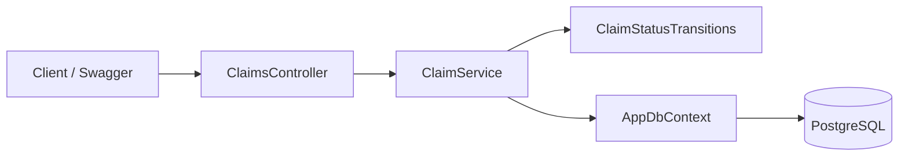
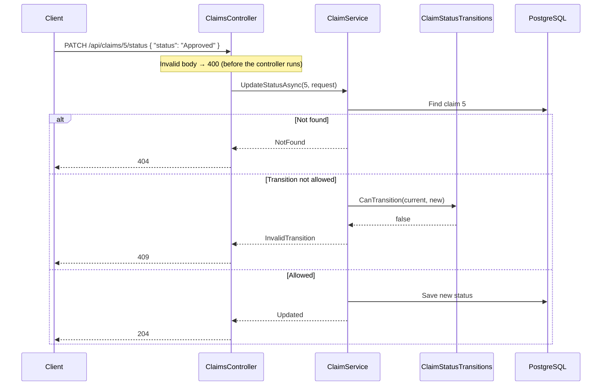
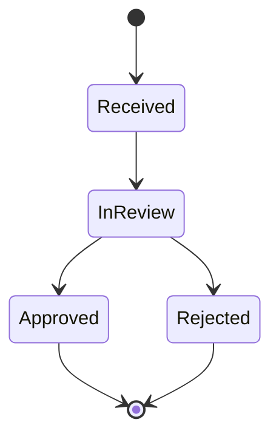

# Claims API

An API where customers submit insurance claims and handlers review, approve or reject them.
Built with ASP.NET Core, EF Core and PostgreSQL, and deployed to Azure.

[](https://github.com/alisha0815/claims-api/actions)


- **Live demo (Swagger):** https://claims-api-jungah-h3fre0dfd8asbeed.swedencentral-01.azurewebsites.net/swagger
- **OpenAPI spec:** https://claims-api-jungah-h3fre0dfd8asbeed.swedencentral-01.azurewebsites.net/openapi/v1.json
- **Health:** https://claims-api-jungah-h3fre0dfd8asbeed.swedencentral-01.azurewebsites.net/health

> Hosted on the free tier. The first request after a quiet period can take 10–30 seconds while the app wakes up.
> The demo database is seeded with sample travel insurance claims in every status.

### Demo account

| Username | Password | Role |
|---|---|---|
| customer | demo-password | Customer |

The admin account is not public. Run the app locally with your own `Admin:*` settings to try admin features.

Login is available after the auth endpoints are added.

---

## Features

- Create, read, update and delete claims
- Filter claims by status (`?status=Approved`)
- Status workflow with enforced transition rules
- Business rules: a claim can only be edited or deleted while it is `Received`
- Validation errors and business rule violations returned as ProblemDetails
- Health check that also verifies the database connection

## Tech stack

| Area | Tools |
|---|---|
| API | .NET 10, ASP.NET Core (controllers) |
| Data | EF Core 10, PostgreSQL 17 |
| Testing | xUnit, Testcontainers (real PostgreSQL in Docker) |
| CI | GitHub Actions |
| Hosting | Azure App Service (F1), Azure Database for PostgreSQL Flexible Server (B1ms) |

## Architecture



The controller handles HTTP only and maps service results to status codes.
The service applies the business rules and uses `ClaimStatusTransitions` to check status changes.
`AppDbContext` reads and writes data in PostgreSQL through EF Core.

## Request flow

Example: changing a claim's status.



## Endpoints

| Method | Path | Description | Responses |
|---|---|---|---|
| GET | `/api/claims` | List claims, newest first. Optional `?status=` | 200, 400 |
| GET | `/api/claims/{id}` | Get one claim | 200, 404 |
| POST | `/api/claims` | Create a claim (starts as `Received`) | 201, 400 |
| PUT | `/api/claims/{id}` | Update a claim (`Received` only) | 204, 400, 404, 409 |
| DELETE | `/api/claims/{id}` | Delete a claim (`Received` only) | 204, 404, 409 |
| PATCH | `/api/claims/{id}/status` | Change status | 204, 400, 404, 409 |
| GET | `/health` | App and database health | 200, 503 |

## Status workflow



Any other transition is rejected with `409 Conflict`. The rules live in
[`ClaimStatusTransitions.cs`](ClaimsApi/Models/ClaimStatusTransitions.cs).

Every claim must be reviewed before a decision, and an approved or rejected claim is final.

## Design decisions

### No repository layer
I used `DbContext` directly because it already supports basic database operations
like reading, adding, updating and deleting data, so I didn't need another layer.
I wanted to avoid abstractions that aren't necessary at this size, and would add one
if the app needed more than one data source.

### Business rules live in the service
I kept the business rules, such as "only `Received` claims can be edited", in `ClaimService`
instead of the controller. The controller only maps the result to an HTTP status code.
This way the tests can call the service directly, without running the web server or sending HTTP requests.

### Transition rules as a pure function
I put the rules for status changes in a separate static function, `ClaimStatusTransitions.CanTransition`.
It doesn't depend on a database or other services, so I can test it easily with `[Theory]` and different inputs.
It only lists the allowed transitions and rejects everything else, because forgetting to allow
a transition is easy to notice, but forgetting to block one could let a claim skip review.

### Result enums instead of exceptions
I used enums for expected results, like `NotFound` or `NotEditable`, instead of throwing exceptions.
These are normal outcomes, not errors, and the enum makes every possible result visible in the method's return type.
Unexpected errors are still handled by the global exception handler.

### Separate request DTOs per endpoint
I used different request DTOs for creating and updating claims.
For example, `PolicyNumber` is included when creating a claim, but not when updating it.
This prevents clients from changing the policy number after the claim has been submitted,
because it links the claim to the policy that decides what is covered.

### Testing against real PostgreSQL
I used Testcontainers with a real PostgreSQL database instead of an in-memory database, so the tests behave like production.
When a test checks saved data, it uses separate DbContexts for arrange, act and assert.
EF Core's change tracker keeps loaded entities in memory, so a new DbContext makes sure the test reads what was actually saved.
The trade-off is slower tests that need Docker, but I think the reliability is worth it.

### Swagger is public in production
This is a portfolio demo, so Swagger is open for reviewers to try the API.
In a real system I would only enable it in development or put it behind authentication.

markdown
### Admin bootstrap from configuration
Handlers are created by an admin through the API, so the first admin has to come from outside the API.
On startup, the app creates an admin from `Admin:Username` and `Admin:Password` if none exists.
The password lives in user-secrets locally and in App Service settings in Azure, so it is never in Git.
The check is idempotent: restarting the app does not create another admin.

## Testing
- **Service tests** cover create, read, update, delete and status changes, including the business rules
  (only `Received` claims can be edited or deleted) and not-found cases. They run against a real PostgreSQL database.
- **Transition rule tests** use `[Theory]` to check every allowed transition and the forbidden ones,
  such as skipping review or changing a final decision.
- **Validation tests** check that the incident date cannot be in the future.

`FakeTimeProvider` keeps time-based tests stable, so they don't depend on the current date.

```bash
dotnet test
```

Docker must be running, because the tests start a PostgreSQL container.

## Run locally

### Prerequisites

- .NET 10 SDK
- Docker
- EF Core CLI: `dotnet tool install --global dotnet-ef`

### Steps
```bash
git clone https://github.com/alisha0815/claims-api.git
cd claims-api

# 1. Start PostgreSQL (Docker, port 5433)
docker compose up -d

# 2. Store the connection string in user-secrets (not committed to Git)
dotnet user-secrets set "ConnectionStrings:ClaimsDb" \
  "Host=localhost;Port=5433;Database=claims;Username=claims;Password=<your-password>" \
  --project ClaimsApi

# 3. (Optional) Configure the admin account. The first admin is created on startup.
dotnet user-secrets set "Admin:Username" "admin" --project ClaimsApi
dotnet user-secrets set "Admin:Password" "<choose-a-password>" --project ClaimsApi

# 4. Apply migrations and run the API
dotnet ef database update --project ClaimsApi
dotnet run --project ClaimsApi
```

Use the same password as `POSTGRES_PASSWORD` in [`docker-compose.yml`](docker-compose.yml).
If `Admin:*` is not set, the app starts normally and skips admin creation.
Open http://localhost:5175/swagger.

Example requests are in [`ClaimsApi/ClaimsApi.http`](ClaimsApi/ClaimsApi.http).
Sample data can be loaded with [`ClaimsApi/demo-data.http`](ClaimsApi/demo-data.http).

## Deployment

| Resource | Azure service | Region |
|---|---|---|
| API | App Service, Linux, F1 | Sweden Central |
| Database | Azure Database for PostgreSQL Flexible Server, B1ms | Norway East |

- The connection string is stored in App Service settings, not in the code.
- The first deployment was manual. Automatic deployment with GitHub Actions is on the roadmap.

The database is in a different region because PostgreSQL Flexible Server (B1ms) was not available
for my subscription in Sweden Central. In production I would keep both in the same region to reduce latency.

## Roadmap

- [x] CRUD with business rules
- [x] Status filter
- [x] Status transitions
- [x] Health check
- [x] Deploy to Azure
- [ ] JWT authentication (in progress)
- [ ] Customers see only their own claims
- [ ] Handler role for approve and reject
- [ ] Automatic deployment with GitHub Actions
- [ ] React frontend
